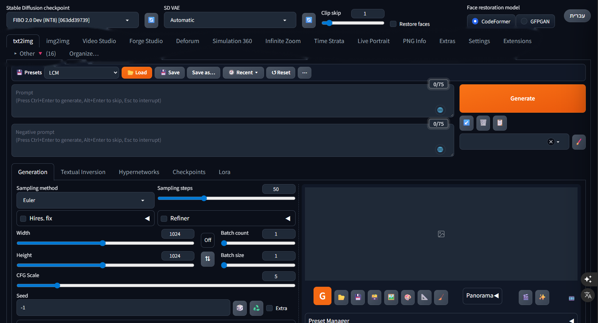

<div dir="rtl">

# פורג' סטודיו (Forge Studio)

**סטודיו All-in-One ליצירת תמונות ווידאו ב-AI, למחשבי Windows עם כרטיס מסך של 8GB.**
בנוי על Stable Diffusion WebUI Forge (A1111), ומרכז תחת קורת גג אחת: FLUX 3, ‏FIBO 2.0, ‏SDXL ו-SD 1.5, וידאו
ב-Wan 2.2, עורך וידאו מובנה, דמויות עקביות, שדרוגים ל-Deforum ול-AnimateDiff, לשוניות לבניית עולמות וכותב
פרומפטים שמבין כל שפה.

> **גרסה ראשונה.** פורג' סטודיו עדיין ניסיונית, אבל היא מכונה לעבודה: כל מה שכאן נמצא בשימוש יומיומי על RTX 3070
> Laptop עם 8GB. יהיו פינות לא מלוטשות, ואשמח לדיווחים.



[English](README.md)

## למה בניתי את זה

הספגטי של ComfyUI עושה לי בחילה, אבל מצד שני רציתי לשאוב קצת מהמהירות והפשטות של המנוע שלו כדי לייצר תהליך עבודה
רציף, והכל ייעודי למחשבים עם זיכרון נמוך: מציירים תמונה, מנפישים אותה, ממשיכים אותה לסרטון ארוך, עורכים על ציר
זמן, מוסיפים סאונד ומייצאים, הכל באותו חלון.

## מה יש בפנים

- **המודלים החדשים:** FLUX 3 Image Klein ו-FIBO 2.0 נבחרים מרשימת ה-checkpoint הרגילה, ליד SDXL ו-SD 1.5. הסמפלר,
  הצעדים וה-CFG מתעדכנים לפי המודל שבחרת, והערכים שלך חוזרים כשחוזרים למודל רגיל.
- **יצירת וידאו (Video Studio):** ‏Wan 2.2 14B מטקסט, מתמונה, מפריים ראשון ואחרון, סרטון ארוך מעד שש תמונות,
  ‏Ingredients to Video (הדמויות והחפצים שלך יחד בסרטון אחד) והחלפת דמות בסרטון (Wan 2.2 Animate).
- **דמויות (לשונית Characters):** מתארים דמות בכל שפה, או נותנים תמונת רפרנס, ו-FLUX 3 Klein מצייר גיליון דמות עקבי
  על תבנית פוזות. שומרים בפרויקטים, ושולחים דמות ל-Ingredients to Video, למודל תלת-ממד או לעולם של Simulation 360.
- **עורך וידאו (לשונית Forge Studio):** עריכה על ציר זמן ברוח CapCut, שבה יצירה, הארכה וציור מחדש של שוטים הם חלק
  מהעריכה; כתוביות, קריינות, מוזיקה ואפקטים; ייצוא באיכות גבוהה. (עדיין בהתהוות.)
- **אנימציה:** ‏Deforum עם קיפריימים לפי מוזיקה, עורך ציר זמן ומסלול מצלמה בתלת-ממד ושליטה חיה ב-DeforumationQT;
  ‏AnimateDiff עם מוזיקה, העברת ריקוד ומסכה לכל פריים.
- **בניית עולמות:** ‏Simulation 360 (עולמות 360°, שערים, אובייקטים בתלת-ממד, מסלול מוקלט ודמויות מדברות) ו-Time
  Strata (פיסול זמן מסרטון).
- **הגדלה:** וידאו ב-Extras עם השוואת לפני/אחרי, Hires. fix ב-Extras, ‏Real-ESRGAN, ו-**NVIDIA RTX Video Super
  Resolution** כמגדיל.
- **פנים:** החלפת פנים (ReActor, בגרסת ה-SFW של המחבר עם מסנן NSFW), ‏LivePortrait, והחלפת פנים בהחלפת דמות של Video Studio.
- **כותב פרומפטים 🌐:** כותבים בכל שפה (גם בעברית) ומקבלים פרומפט באנגלית שמתאים בדיוק למודל שעליו אתה עומד.
  ‏👍 / 👎 מלמדים אותו.
- **"סשנים" (Tab Presets):** שמירה, טעינה ואיפוס של לשונית שלמה, כולל יחידות ControlNet עם התמונות שלהן,
  AnimateDiff וכל אפשרות, עם רשימת אחרונים.
- **שפת הממשק:** אנגלית, ותרגום מלא לעברית בלחיצה אחת. לכל שפה אחרת: נותנים את ערכת התרגום ל-AI שלכם (ChatGPT,
  ‏Claude, ‏Gemini...) וטוענים את מה שהוא מחזיר.
- **הכל רץ על 8GB VRAM בלבד** 🚀: כל רכיב חדש נכתב ונמדד על כרטיס של 8GB.

## דרישות

- ‏Windows 10 או 11 (64 ביט)
- כרטיס NVIDIA עם **8GB** זיכרון מסך ומעלה (מומלץ RTX 20xx ומעלה), ודרייבר 560 ומעלה
- ‏16GB זיכרון מחשב לפחות (32GB ומעלה מומלץ לווידאו)
- כ-15GB בדיסק לפורג' סטודיו עצמה, ועוד המודלים שבוחרים (מ-0.6GB ועד כ-92GB)
- חיבור לאינטרנט בזמן ההתקנה

לא צריך שום דבר אחר: המתקין מביא Python, ‏git ומנהל חבילות לתוך התיקייה של פורג' סטודיו, ולא משנה כלום במחשב.

## התקנה

1. מורידים את פורג' סטודיו: ב-GitHub ‏**Code ← Download ZIP** (או `git clone https://github.com/Shai7net/forge-studio`),
   ושמים בנתיב קצר בלי עברית, למשל `C:\AI\ForgeStudio`.
2. לחיצה כפולה על **`install.bat`**. הוא בודק את המחשב, מתקין הכל ושואל אילו מודלים להוריד.
3. מפעילים את **Forge Studio** מקיצור הדרך בשולחן העבודה. היא נפתחת בחלון משלה, בלי הדפדפן.

ההפעלה הראשונה לוקחת כמה דקות; אחר כך בערך דקה.

### מה המתקין עושה

1. בודק את Windows, כרטיס המסך והדרייבר, המקום בדיסק והנתיב.
2. מביא את uv, ‏Python 3.10.11 ו-git (רק אם חסר) לתוך `system\`.
3. בונה את סביבת ה-Python של Forge עם הגרסאות המדויקות שעליהן פורג' סטודיו נבנתה (PyTorch 2.6 עם CUDA 12.6
   ועוד כ-240 חבילות).
4. מוריד את ההרחבות של מפתחים אחרים בדיוק בגרסה שבה הן נבדקו, ומחיל עליהן את השינויים של פורג' סטודיו.
5. מתקין את **DeforumationQT** ליד Forge, ואת **llama.cpp** בשביל כותב הפרומפטים.
6. כותב הגדרות התחלה, רשימת סגנונות וסידור לשוניות (קבצים שלך אף פעם לא נדרסים).
7. מוריד את המודלים שבחרת ויוצר את קיצור הדרך **Forge Studio** בשולחן העבודה.

הכל נרשם ב-`installer\install.log`.

### מודלים

| בחירה | גודל | מה מקבלים |
|---|---|---|
| מינימום | ‏0.6GB | ה-LoRA של LCM ל-SD 1.5 ול-SDXL וה-LoRA של הפנורמה 360° (יורדים תמיד). את ה-checkpoints מביאים לבד (כשאין אף אחד, Forge מוריד Realistic Vision 5.1 בגודל 2GB בהפעלה הראשונה) |
| **מומלץ** | ‏21GB | מינימום + SD 1.5 (DreamShaper 8 ומודל ה-inpainting שלו), ‏AnimateDiff ‏(AnimateLCM, v3), ‏ControlNet בסיסי + QR Monster + IP-Adapter, מגדילים וכותב הפרומפטים |
| וידאו | ‏50GB | מומלץ + וידאו ב-Wan 2.2 והחלפת דמות |
| הכל | ‏92GB | כל הנ"ל + SDXL ‏(Juggernaut XL), עוד AnimateDiff ו-ControlNet (כולל SDXL Union), ‏FIBO 2.0 ו-FLUX 3 |
| קבוצה-קבוצה | | בוחרים מתוך 15 קבוצות |

עוד מודלים בכל זמן עם **`download-models.bat`**. הורדה שנקטעה ממשיכה מאיפה שעצרה, וכל קובץ נבדק מול ה-sha256 שלו.

**FLUX 3** נעול: נכנסים [לעמוד שלו](https://huggingface.co/black-forest-labs/flux-3-image-klein-comfy) עם חשבון
Hugging Face, מאשרים את הרישיון, יוצרים טוקן קריאה ב-[huggingface.co/settings/tokens](https://huggingface.co/settings/tokens)
ונותנים אותו כשהמתקין שואל. הטוקן משמש רק להורדה ולא נשמר.

המשקולות של **FIBO 2.0** ברישיון של Bria לשימוש לא מסחרי (CC BY-NC 4.0).

### התקנה בלי שאלות (סקריפטים וסוכני AI)

```bat
install.bat -Yes -Models recommended
install.bat -Yes -Models all -HfToken hf_xxxxxxxx
```

סוכן AI (Claude Code, Codex וכו') יכול להתקין לבד לפי [AGENTS.md](AGENTS.md).

## שימוש

### איזה מודל לאיזו לשונית

| משפחת מודלים | עובדת ב- |
|---|---|
| **SD 1.5** | ‏txt2img, ‏img2img, ‏**AnimateDiff**, ‏**Deforum**, ‏Infinite Zoom, ‏Time Strata, ‏Simulation 360, רוב ה-ControlNet |
| **SDXL** | ‏txt2img, ‏img2img, ‏**Deforum**, ‏ControlNet Union |
| **FLUX 3** | ‏txt2img, ‏img2img (עריכה עם התמונה כרפרנס), ‏LoRA של FLUX 3 |
| **FIBO 2.0** | ‏txt2img ו-img2img: יצירה ועריכה לפי הוראה עם עד ארבע תמונות רפרנס |
| **Wan 2.2** | ‏Video Studio |

**בשביל לג'נרט ב-AnimateDiff וב-Deforum צריך להשתמש במודלים מהדור הקודם (SD 1.5, ו-SDXL גם ל-Deforum).**

### הלשוניות

`txt2img` · `img2img` · `Video Studio` · `Characters` · `Forge Studio` · `Deforum` · `Simulation 360` · `Infinite Zoom` ·
`Time Strata` · `Live Portrait` · `PNG Info` · `Extras` · `Settings` · `Extensions`, ותיקיית **Other** עם השאר.
אפשר לסדר אותן מחדש עם **Organize…**.

### כותב הפרומפטים 🌐
כפתור 🌐 בכל תיבת פרומפט. כותבים את הרעיון בעברית או בכל שפה אחרת, והוא כותב פרומפט כמו שהמודל של אותה תיבה קורא הכי טוב:
ביטויים עם פסיקים ל-SD 1.5, משפט ופרטים ל-SDXL, פרוזה ל-FLUX, ‏JSON מובנה ל-FIBO, ושוט רציף עם תנועה ומצלמה
לווידאו. מתחת לתיבה הוא מראה מה הבין; ‏👍 שומר את הפרומפט (כולל התיקונים שלך) כדוגמה, ‏👎 כותב גרסה אחרת, והערה
כמו `קיפוד = hedgehog` מלמדת אותו מילה לתמיד. רץ מקומית (Gemma 4 דרך llama.cpp), בערך שנייה וחצי לפרומפט.

### Video Studio: ‏Ingredients to Video
עד ארבע תמונות (אנשים, חיות, חפצים, או גיליון דמות מלשונית Characters) בסרטון אחד, עם מה שהן עושות שכותב ה-🌐
מנסח. בדרך ברירת המחדל FLUX 3 Klein מצייר מהן את הפריים הראשון ו-Wan 2.2 מנפיש אותו, ולכן **צריך ש-FLUX 3 Klein
יהיה ה-checkpoint הנבחר**. הדרך השנייה, Phantom-Wan 14B, מכניסה אותן ישר לסרטון; את המודל שלה (7.2GB) מורידים
בכפתור שבלשונית.

### דמויות (Characters)
מתארים דמות בכל שפה, או מעלים תמונת רפרנס, ו-FLUX 3 Klein (נבחר בראש העמוד) מצייר גיליון דמות עקבי על תבנית פוזות:
מלפנים, מהצד, מאחור, פנים ותקריב. התבנית היא גיליון OpenPose שמגיע עם הלשונית, ואפשר לשים תבנית משלכם ולקבוע אותה
כברירת מחדל. הדמויות נשמרות בפרויקטים (הצגת הכל, חיפוש, שינוי שם, העברה ומחיקה לסל), ומכל דמות אפשר לשלוח:
- ל-**Ingredients to Video**, עם פרומפט Wan שנכתב למה שהיא צריכה לעשות;
- ל-**מודל תלת-ממד** (🧊, דרך Hunyuan3D-2: אותו כלי אופציונלי ש-Simulation 360 משתמש בו לאובייקטים);
- לעולם של **Simulation 360** (🌍), שבו המודל עומד, הולך ומואר לפי העולם.

### שפת הממשק
כפתור השפה בפינה העליונה מחליף את כל הממשק בלחיצה אחת בין אנגלית לשפה האחרונה שבחרתם, וה-▾ לידו מציג את כל
השפות. עברית מגיעה מובנית.

**כל שפה אחרת, עם ה-AI שלכם:** ▾ ← **Add a language…** נותן את *ערכת התרגום*: כ-5,000 טקסטים של הממשק וטקסטי
העזרה, באנגלית, ב-17 קבצים קטנים עם הכללים בתוכם. נותנים את הקבצים לכל AI (ChatGPT, ‏Claude, ‏Gemini... כמה בכל
פעם) עם הבקשה שמופיעה שם, וטוענים באותו חלון את הקבצים שהוא מחזיר. השפה מופיעה מיד בתפריט; מה שלא תורגם נשאר
באנגלית, כך שאפשר לתרגם בחלקים. סוכן קוד יכול לתרגם את כל הערכה בבת אחת (ראו [AGENTS.md](AGENTS.md)).

### סגנונות
רשימת הסגנונות היא הקובץ `forge/webui/styles.csv`: עורכים אותה בממשק (כפתור המכחול 🖌️ ליד הסגנונות) או בכל עורך
טקסט (עמודות: שם, פרומפט, פרומפט שלילי). הסגנונות עובדים גם ב-Video Studio.

### "סשנים" (Tab Presets)
בכל לשונית יש סרגל **Save / Load / Recent / Reset** ששומר וטוען את כל מה שבלשונית, כולל ControlNet עם התמונות
ו-AnimateDiff, כך שסביבת עבודה שלמה חוזרת בלחיצה.

## כלים אופציונליים

חלק מהיכולות משתמשות בתוכנות נפרדות שלא מותקנות אוטומטית בגרסה הזו (FaceFusion, ‏MMAudio, ‏ACE-Step, ‏Whisper,
‏Hunyuan3D, שמשמש גם למודל התלת-ממד של דמות). שמים כל אחת **ליד התיקייה `forge`**, והלשונית שמשתמשת בה מוצאת אותה. הפרטים ב-[README.md](README.md#optional-tools).
מצב החיות של LivePortrait צריך CUDA Toolkit 12.6 מותקן ב-Windows; לאנשים הוא עובד גם בלעדיו.

## עדכון

הדרך הקצרה: כפתור הצפרדע העגול 🐸 **Check for updates** ליד *Language* בראש Forge. הוא בודק ב-GitHub אם יש גרסה חדשה, ובאישורכם מוריד אותה ומפעיל את Forge מחדש כדי להחיל אותה. כשהשתנו חבילות או הרחבות הוא יבקש להריץ `update.bat`.

**`update.bat`** מושך את הגרסה החדשה ומריץ שוב את ההתקנה, ושומר את המודלים, התוצרים וההגדרות שלך.
הרחבות של מפתחים אחרים נשארות בגרסאות ש-Forge Studio נבדק איתן, ולכן אל תעדכנו אותן מלשונית Extensions של Forge:
`update.bat` מעביר אותן לגרסה חדשה כשגרסה חדשה של Forge Studio עושה זאת. הרחבה ששיניתם בעצמכם נשארת כמו שהיא.

## קרדיטים ורישיונות

פורג' סטודיו עומדת על העבודה של הרבה אנשים: Stable Diffusion WebUI Forge של lllyasviel, ה-WebUI של AUTOMATIC1111,
‏Deforum, ‏AnimateDiff, ‏ControlNet, ‏DeforumationQT, ‏ComfyUI, ‏llama.cpp, וכל מפתחי ההרחבות והמודלים. ראו
[THIRD_PARTY.md](THIRD_PARTY.md). הקוד משוחרר תחת **GNU AGPL-3.0**, כמו Forge עצמו. המודלים יורדים מהיוצרים שלהם
ונשארים ברישיונות שלהם.

נבנה על ידי שי טירי.

</div>
