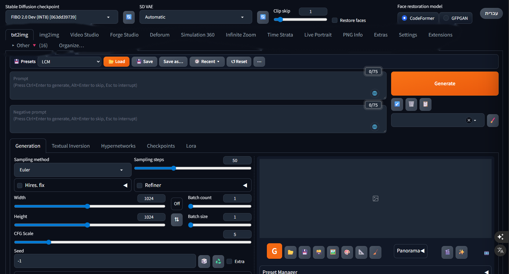

# Forge Studio

**An all-in-one AI image and video studio for Windows PCs with 8 GB graphics cards.**
Built on Stable Diffusion WebUI Forge (A1111), with FLUX 3, FIBO 2.0, SDXL and SD 1.5, Wan 2.2 video, a video
editor, Deforum and AnimateDiff upgrades, world-building tabs and a Hebrew-aware prompt writer, all under one roof.

> **First version.** Forge Studio is still experimental, but it is a working machine: everything here is used
> every day on an RTX 3070 Laptop (8 GB VRAM). Expect rough edges and please report them.



[עברית](README.he.md)

## Why

ComfyUI's spaghetti of nodes makes me dizzy, but its engine is fast and simple. Forge Studio takes that speed and
simplicity into Forge's familiar tabs, for one continuous way of working that fits PCs with little video memory:
draw a picture, animate it, continue it into a longer video, edit it on a timeline, add sound, export, all in
the same window.

## What is in it

| | |
|---|---|
| **Newest image models** | FLUX 3 Image Klein and FIBO 2.0, picked from the normal checkpoint list next to SDXL and SD 1.5; the sampler, steps and CFG follow the model you choose |
| **Video generation** | **Video Studio**: Wan 2.2 14B text/image/first-and-last-frame video, longer videos from up to six pictures, and *Replace a character* (Wan 2.2 Animate) |
| **Video editor** | **Forge Studio** tab: a timeline editor in the spirit of CapCut, where generating, extending and repainting shots is part of the edit; captions, narration, music and effects; exports in high quality |
| **Animation** | Deforum with music-driven keyframes, a drawn timeline + 3D camera path editor and DeforumationQT live control; AnimateDiff with music, dance transfer and per-frame inpainting masks |
| **World building** | **Simulation 360**: 360° worlds with portals, 3D objects, a recorded route and talking characters. **Time Strata**: turn a video into a sculpture of time |
| **Upscaling** | Extras for video with a before/after viewer, Hires. fix in Extras, Real-ESRGAN, and NVIDIA RTX Video Super Resolution as an upscaler |
| **Faces** | Face swap (ReActor, the author's SFW edition with its NSFW filter), LivePortrait, and face swap in Video Studio's character replacement |
| **Prompt writer** | 🌐 in every prompt box: write your idea in Hebrew (or any language) and get an English prompt written for the model you are on; 👍 / 👎 teach it |
| **Sessions** | Tab Presets: save, load and reset a whole tab (ControlNet units and pictures, AnimateDiff, every option), with a list of recent ones |
| **Hebrew interface** | One click switches the whole interface to Hebrew and back |
| **8 GB first** | Every new piece was written and measured on an 8 GB card: int8 engines, streaming of model blocks, tiled decoding |

## Requirements

- Windows 10 or 11, 64-bit
- An NVIDIA graphics card with **8 GB** of video memory or more (RTX 20xx or newer recommended) and a driver from
  560 on (it ships CUDA 12.6 support)
- 16 GB of system memory at least, 32 GB or more recommended for video
- About 15 GB of disk for Forge Studio itself, plus the models you choose (from 0.6 GB to about 92 GB)
- An internet connection during setup

Nothing else: the installer brings its own Python, git and package manager into the Forge Studio folder and changes
nothing system-wide.

## Install

1. Download Forge Studio: **Code → Download ZIP** on GitHub (or `git clone https://github.com/Shai7net/forge-studio`),
   and put it in a short path without non-English letters, for example `C:\AI\ForgeStudio`.
2. Double-click **`install.bat`**. It checks your PC, installs everything, and asks which models to download.
3. Start **Forge Studio** from the desktop shortcut it made. It opens in its own window.

The first start takes a few minutes (Forge prepares itself); later starts take about a minute.

### What the installer does

1. Checks Windows, the NVIDIA card and driver, the free disk space and the folder path.
2. Brings [uv](https://github.com/astral-sh/uv), Python 3.10.11 and (only if missing) git into `system\`.
3. Creates Forge's Python environment with the exact package versions Forge Studio was built with
   (`installer\requirements-lock.txt`: PyTorch 2.6 with CUDA 12.6, xformers, ~240 packages).
4. Fetches the extensions by other authors at the exact versions used (`installer\extensions.json`) and applies
   Forge Studio's changes to some of them (`installer\patches`).
5. Installs **DeforumationQT** next to Forge (its own environment) and **llama.cpp** for the prompt writer.
6. Writes the starting settings, the style list and the tab layout (your own files are never overwritten).
7. Downloads the models you pick, then makes the **Forge Studio** desktop shortcut.

Everything is logged to `installer\install.log`.

### Models

| Choice | Size | What you get |
|---|---|---|
| Minimal | ~0.6 GB | The LCM LoRAs for SD 1.5 and SDXL and the 360° panorama LoRA (always downloaded). Bring your own checkpoints (with none at all, Forge fetches Realistic Vision 5.1, 2 GB, at the first start) |
| **Recommended** | ~21 GB | Minimal + SD 1.5 (DreamShaper 8 and its inpainting model), AnimateDiff (AnimateLCM, v3), ControlNet essentials (fp16) + QR Monster + IP-Adapter, upscalers, the prompt writer |
| Video | ~50 GB | Recommended + Wan 2.2 image-to-video and character replacement |
| Everything | ~92 GB | All of the above + SDXL (Juggernaut XL), more AnimateDiff and ControlNet (SDXL Union), FIBO 2.0, FLUX 3 |
| Group by group | | Pick any of the 15 groups in `installer\models.json` |

More later at any time with **`download-models.bat`**. Downloads resume where they stopped and are checked against
their sha256.

**FLUX 3** is gated: open [its page](https://huggingface.co/black-forest-labs/flux-3-image-klein-comfy), accept the
FLUX Kommunity License with a Hugging Face account, make a *Read* token at
[huggingface.co/settings/tokens](https://huggingface.co/settings/tokens), and give it when the installer asks (or
`download-models.bat -Models flux3 -HfToken hf_...`). The token is used for that download only and not stored.

**FIBO 2.0** weights are licensed by Bria for non-commercial use (CC BY-NC 4.0).

### Install without questions (scripts and AI agents)

```bat
install.bat -Yes -Models recommended
install.bat -Yes -Models all -HfToken hf_xxxxxxxx
install.bat -Yes -Models sd15,animatediff,controlnet,video -NoShortcut
```

`-Yes` accepts every default and never waits for input; the exit code is 0 on success. AI coding agents: see
[AGENTS.md](AGENTS.md) for the full procedure and how to verify the result.

## Using it

**Forge Studio.bat** (or the desktop shortcut) starts the server and opens Forge Studio in an Edge app window
(Chrome if Edge is missing, otherwise your browser). The minimized console is the server: closing it stops Forge
Studio. To open the window again while it runs, start the shortcut again. The address is `http://127.0.0.1:7860`.

### Which model for which tab

| Model family | Works in |
|---|---|
| **SD 1.5** (DreamShaper 8...) | txt2img, img2img, **AnimateDiff**, **Deforum**, Infinite Zoom, Time Strata, Simulation 360, most ControlNets |
| **SDXL** (Juggernaut XL...) | txt2img, img2img, **Deforum**, ControlNet Union |
| **FLUX 3 Image Klein** | txt2img, img2img (editing with the picture as a reference), FLUX 3 LoRAs |
| **FIBO 2.0** (Dev, Edit Turbo) | txt2img and img2img: generation and editing by instruction with up to four references |
| **Wan 2.2** | Video Studio |

**AnimateDiff and Deforum work with the previous generation of models (SD 1.5, and SDXL for Deforum).** Choose
an SD 1.5 checkpoint for them; with FLUX 3 or FIBO selected they do not run (FIBO tells you so).

When you choose a FLUX 3 or FIBO checkpoint, the sampler, steps, CFG and size are set for it; when you go back to
an ordinary checkpoint, your own values return (they are kept even across a page reload).

### The tabs

`txt2img` · `img2img` · `Video Studio` · `Forge Studio` · `Deforum` · `Simulation 360` · `Infinite Zoom` ·
`Time Strata` · `Live Portrait` · `PNG Info` · `Extras` · `Settings` · `Extensions`, and an **Other** folder with
the rest. Drag tabs between the bar and folders with **Organize…** (Navigation Bookmarks).

## Features

### 🌐 Prompt writer (Hebrew → English, per model)
A 🌐 button in each prompt box (txt2img, img2img, negative prompts, Video Studio). Write the idea in Hebrew or any
language; it writes the prompt the way the model behind that box reads best: comma phrases with quality words for
SD 1.5, a sentence plus details for SDXL, flowing prose for FLUX, FIBO's structured JSON caption, or one continuous
shot with motion and camera for Wan video. Under the box it shows what it understood, and:
- **👍** keeps the prompt (with your corrections) as an example to write like;
- **👎** writes another version and asks what was wrong; a note like `קיפוד = hedgehog` teaches it a word for good.

It runs Gemma 4 E4B (Google) locally through llama.cpp, about 1.5 s per prompt, and leaves the graphics card
before any generation starts.

### FLUX 3 Image Klein
Black Forest Labs' model as a normal checkpoint, with its own int8 engine for 8 GB cards: 1024×1024 in about 25 s
(16 steps), edits with the img2img picture as a reference, FLUX 3 LoRAs, and a built-in prompt writer.

### FIBO 2.0
Bria's model for generating and, above all, editing pictures by instruction: in img2img (or with up to four
reference pictures in the FIBO panel), an optional exact mask, and JSON captions for fine control. It runs in its own
environment (installed by the installer or the panel's button), so Forge's own packages stay untouched.

### Video Studio (Wan 2.2)
- Text to video, image to video, first + last frame, and up to six pictures joined into one longer video, each
  part with its own description.
- *Replace a character*: the person in a video becomes the character in your picture; motion, expressions and
  background stay.
- Continue from the last frame, Refine (a video "Hires. fix"), FILM smoothing and Real-ESRGAN enlargement.
- Styles from the style list, `<lora:...>` tags for Wan LoRAs, and the 🎬 button under txt2img/img2img results
  that sends the picture to Video Studio.
- Sound for the video: AI sound effects and speech (optional tools, see below).

### Forge Studio (video editor)
A timeline editor inside Forge: media panel, layers, keyframes and ready-made moves, speed changes, fades and
dissolves, text and captions; generate a shot from words, continue or remake a clip, repaint a frame and carry it
through the clip, join two shots with AI, separate a person onto a new background; narration, music and sound
effects where they are needed; export in high quality.

### Deforum (upgraded)
- **Audio Keyframes**: music-driven camera and strength keyframes, with listening, marking and camera directing.
- **Map Key**: a drawn timeline and 3D camera-path editor.
- **DeforumationQT built in**: an ON/OFF switch in the Deforum tab and *Open DeforumationQT* to steer the camera,
  prompts and strength live while it renders (DeforumationQT comes installed beside Forge).
- Live video mode control (move a video render into 2D/3D while it runs), direction tools on every motion field,
  steadier zoom and motion.

### AnimateDiff (upgraded)
🎵 Music (motion to the beat), 💃 Dance transfer (a dance video's movement onto your characters through
silhouettes and OpenPose), a mask per frame for inpainting a static picture, ControlNet per context window (much less
memory), and a choice of 8/12/24 FPS.

### Simulation 360
Build 360° worlds and move through them: portals between worlds, 3D objects that stand on the pictured ground,
rain, a recorded route with a camera that follows a figure, cuts between cameras, and characters that talk.

### Time Strata
Turns a video into a sculpture of time: layers of the moving subject along a 3D camera path, subject extraction,
riding and following cameras, and video export. Also on its own: [sd-forge-time-strata](https://github.com/Shai7net/sd-forge-time-strata).

### Extras for video
Upscale and restore whole videos with a before/after viewer (draggable line), Hires. fix in Extras for pictures
and videos, steady faces between frames, and **NVIDIA RTX Video Super Resolution** as an upscaler.

### Tab Presets (sessions)
A bar on every tab: **Save**, **Load**, **Recent** and **Reset** of everything on the tab, ControlNet units with
their pictures and AnimateDiff included, so a whole working setup comes back with one click.

### Styles
The style list (the selector under Generate) is the file `forge/webui/styles.csv`: edit it in the interface (the 🖌️
button next to the styles) or in any text editor (columns: name, prompt, negative prompt). Forge Studio's own
styles (for example the LCM LoRA ones) are there to start from, and Forge's integrated styles in
`styles_integrated.csv`. Styles also work in Video Studio.

### Hebrew interface
The **עברית / English** button at the top right switches the whole interface; the choice is remembered.

## Optional tools

Some features use separate programs that are not installed automatically in this version. Put each one **next to
the `forge` folder** (in the Forge Studio folder) and the tab that uses it finds it:

| Tool | Folder | Used by |
|---|---|---|
| [FaceFusion](https://github.com/facefusion/facefusion) 3.x | `facefusion\facefusion` (with its own `venv`) | Video Studio face swap, LivePortrait's face detector, Simulation 360 talking faces |
| [MMAudio](https://github.com/hkchengrex/MMAudio) | `MMAudio-main` (with its own `venv`) | AI sound effects in Video Studio and Forge Studio |
| [ACE-Step 1.5](https://github.com/ace-step/ACE-Step) | `ACE-Step-1.5` (with `.venv`) | Music in Forge Studio |
| [Whisper](https://github.com/openai/whisper) (auto-subtitle) | `auto-subtitle-main` (with `venv`) | Captions in Forge Studio |
| [Hunyuan3D-2](https://github.com/Tencent/Hunyuan3D-2) (e.g. through Pinokio) | | 3D objects in Simulation 360 |
| [CUDA Toolkit 12.6](https://developer.nvidia.com/cuda-12-6-0-download-archive) | installed in Windows | LivePortrait's animal mode (XPose is built at the next start); people work without it |

Each tab says when a tool is missing and what it would add.

## Folders

```
ForgeStudio\
  Forge Studio.bat      start
  install.bat           setup (run again any time: it only adds what is missing)
  download-models.bat   more models
  update.bat            newest version from GitHub
  installer\            the installer, model catalog, package lock, patches, default settings
  forge\webui\          Forge with Forge Studio's extensions
    models\             checkpoints, LoRAs, ControlNet, VAE, Video Studio, FIBO...
    outputs\            your pictures and videos
  DeforumationQT\       Deforum's live control panel
  system\               Python, uv, git, ffmpeg, llama.cpp and caches (made by the installer)
```

## Updating

Run **`update.bat`**: it pulls the newest version and runs the setup again, keeping your models, outputs and
settings. If you changed Forge Studio's own files, git may refuse; move your changes aside first.

Extensions by other authors stay at the versions Forge Studio was tested with, so do not update them from Forge's
*Extensions* tab: `update.bat` moves each one when a new Forge Studio version does. An extension you changed by hand
is left as it is.

## Troubleshooting

- **The installer stops**: read `installer\install.log`; run `install.bat` again, it continues where it can.
- **"CUDA" or "no GPU" errors**: update the NVIDIA driver (560 or newer).
- **Out of memory**: lower the size, use the int8 models, close other programs using the GPU; for cards under 8 GB
  add `--medvram` to `forge\webui\webui-user.bat`.
- **A tab is missing**: Extensions tab → make sure it is ticked → *Apply and restart UI*.
- **Path too long**: install closer to the drive root (`C:\AI\ForgeStudio`).

## Credits and licenses

Forge Studio stands on the work of many people: [Stable Diffusion WebUI Forge](https://github.com/lllyasviel/stable-diffusion-webui-forge)
by lllyasviel, [AUTOMATIC1111's WebUI](https://github.com/AUTOMATIC1111/stable-diffusion-webui), Deforum,
AnimateDiff, ControlNet, DeforumationQT, ComfyUI (FIBO's runtime), llama.cpp and the authors of every extension and
model. See [THIRD_PARTY.md](THIRD_PARTY.md).

Forge Studio's code is released under the **GNU AGPL-3.0** (as Forge itself). Models are downloaded from their
authors and keep their own licenses (shown in `installer\models.json`); some, like FIBO 2.0, are non-commercial.

Made by Shai Tiri.
