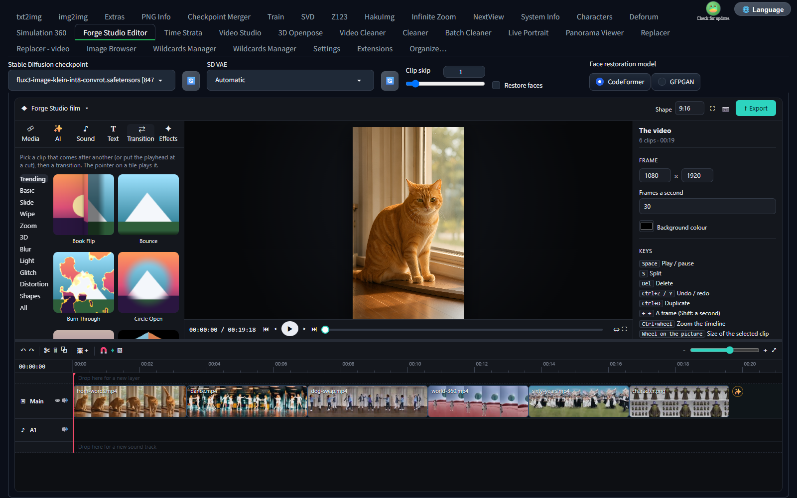
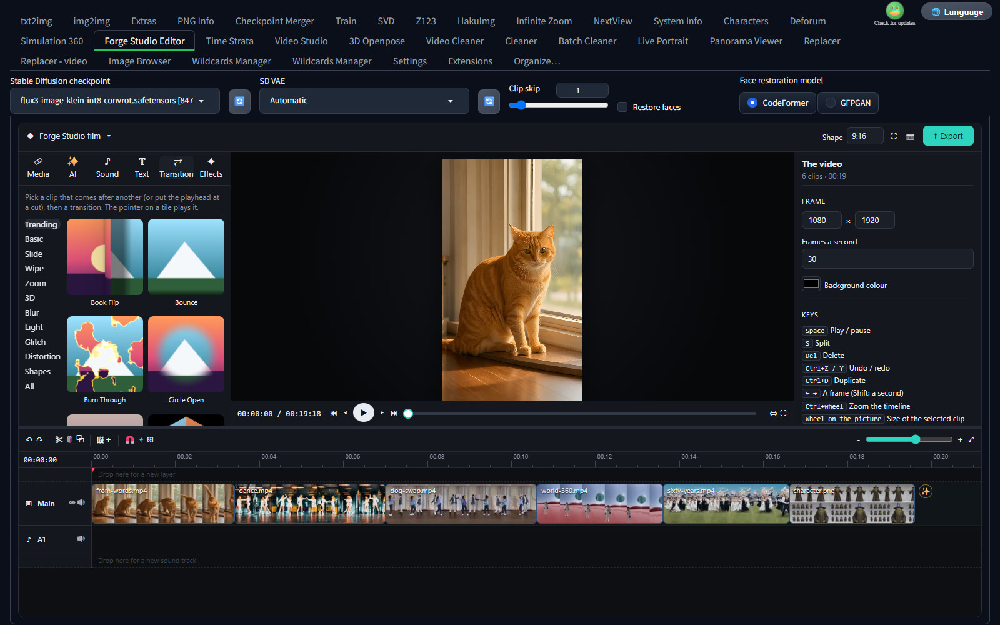
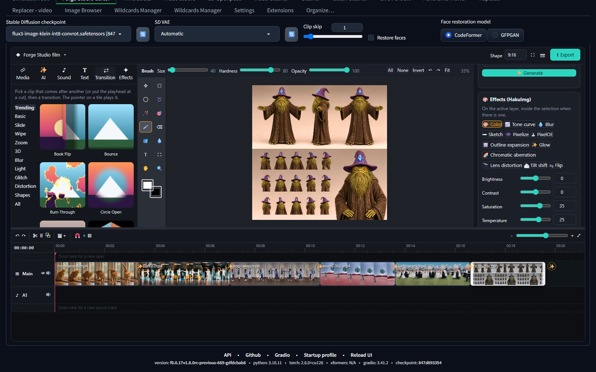
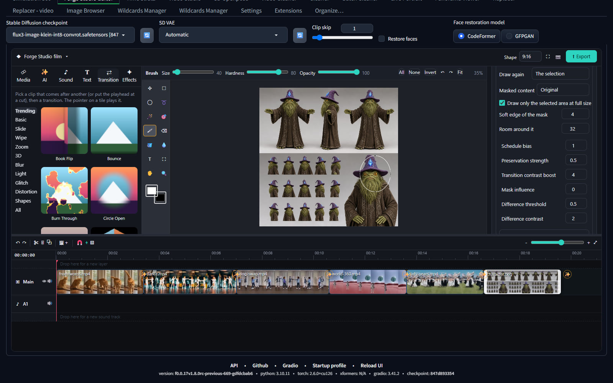
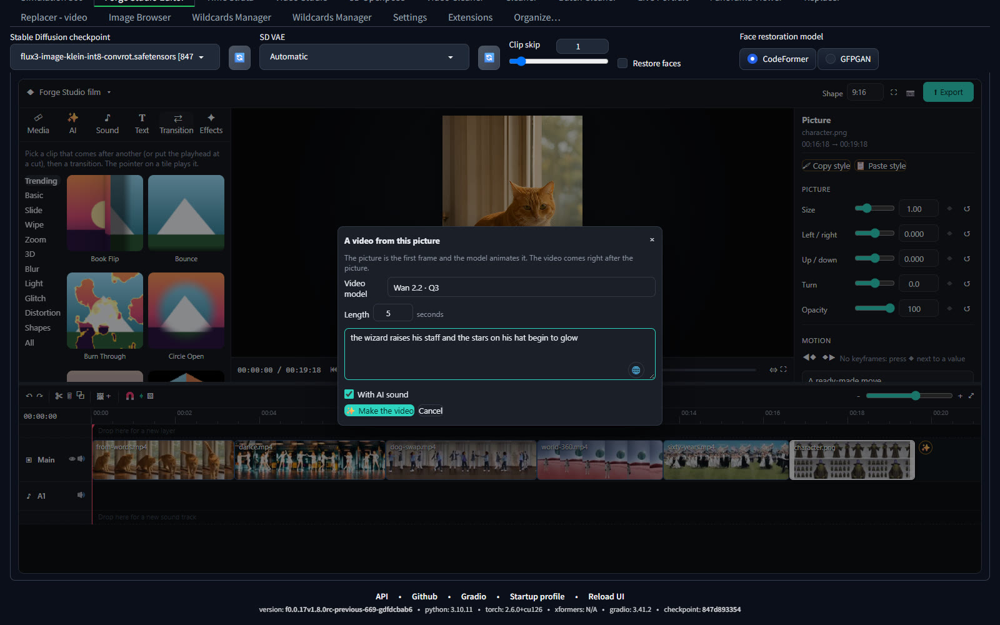
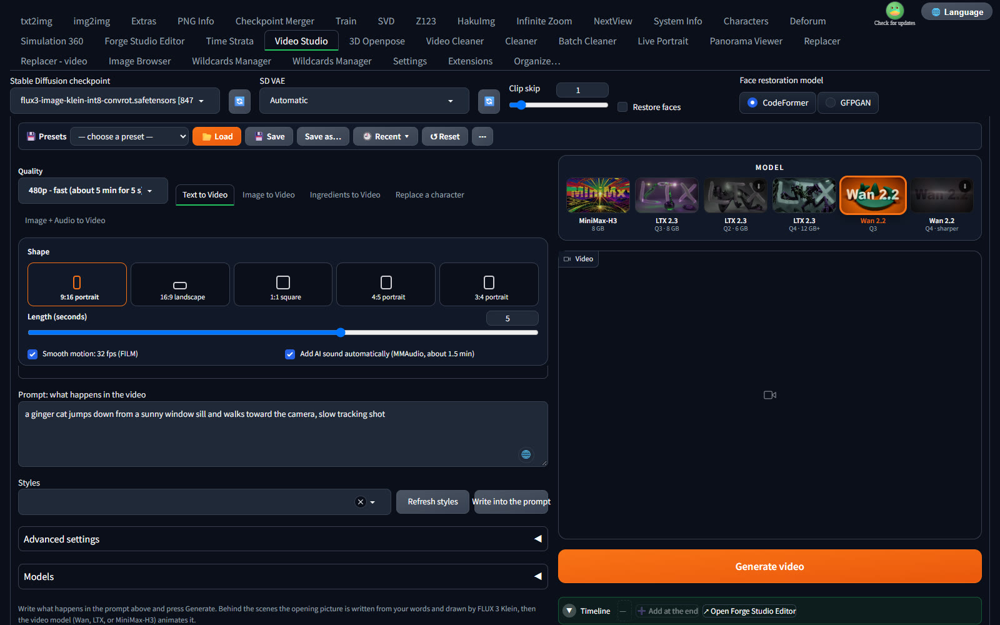
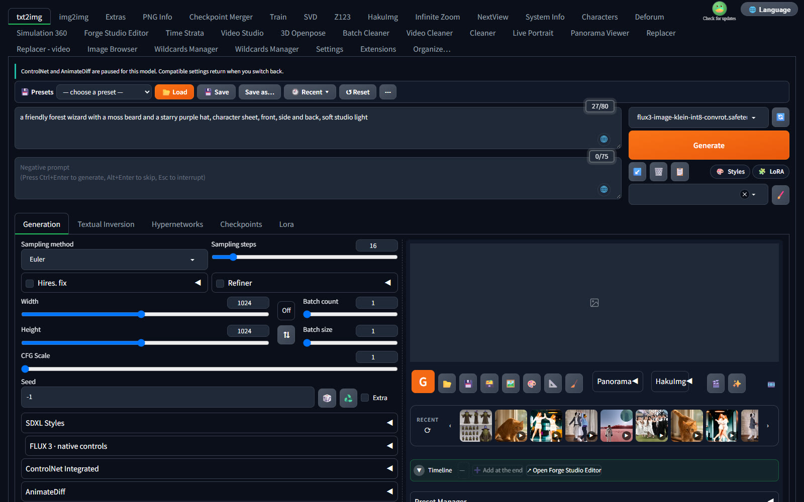
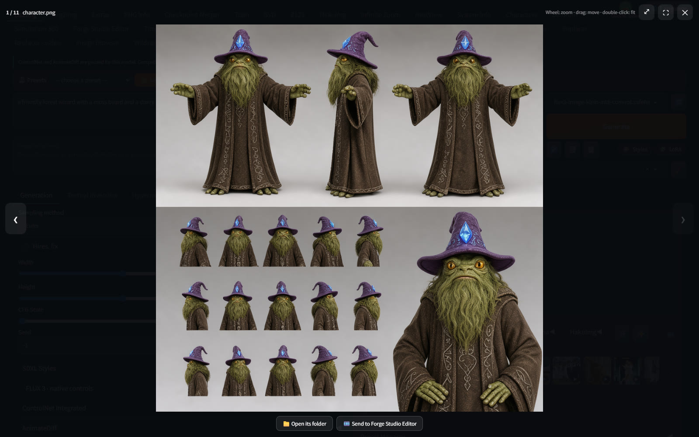
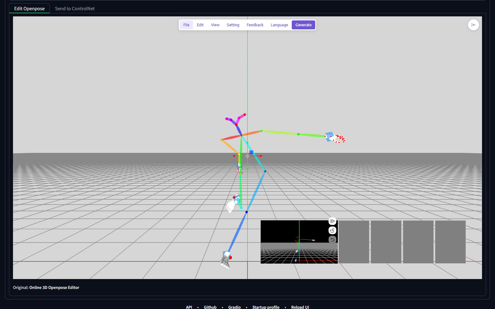
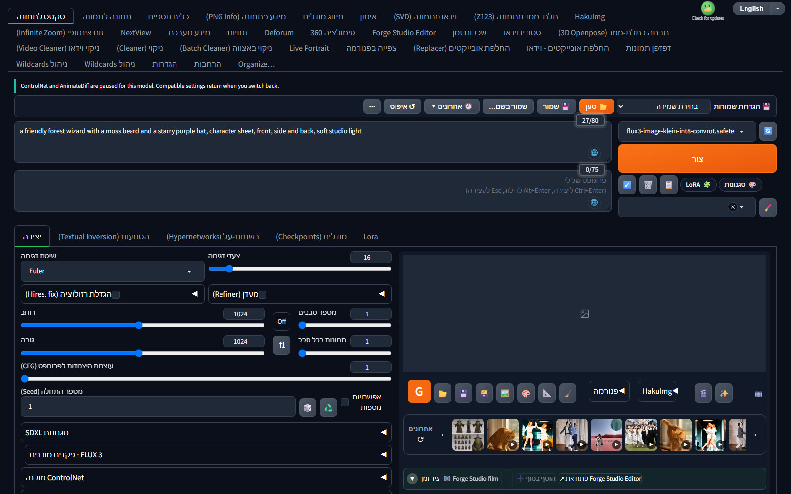

# Forge Studio

**An all-in-one AI image and video studio for Windows PCs with 8 GB graphics cards.**
Built on Stable Diffusion WebUI Forge (A1111), with FLUX 3, FIBO 2.0, SDXL and SD 1.5, Wan 2.2, LTX 2.3 and MiniMax-H3 video,
a video editor with its own image workspace, consistent characters, Deforum and AnimateDiff upgrades, world-building
tabs and a prompt writer that takes any language, all under one roof.

> **First version.** Forge Studio is still experimental, but it is a working machine: everything here is used
> every day on an RTX 3070 Laptop (8 GB VRAM). Expect rough edges and please report them.



[עברית](README.he.md) · **▶ [The film](https://github.com/Shai7net/forge-studio-pinokio/blob/main/media/forge-studio-film.mp4)**
(23 s: every shot, and the music, made in Forge Studio) · **Install with one click in
[Pinokio](https://github.com/Shai7net/forge-studio-pinokio)**

## Why

ComfyUI's spaghetti of nodes makes me dizzy, but its engine is fast and simple. Forge Studio takes that speed and
simplicity into Forge's familiar tabs, for one continuous way of working that fits PCs with little video memory:
draw a picture, animate it, continue it into a longer video, edit it on a timeline, add sound, export, all in
the same window.

## What is in it

| | |
|---|---|
| **Newest image models** | FLUX 3 Image Klein and FIBO 2.0, picked from the normal checkpoint list next to SDXL and SD 1.5; the sampler, steps and CFG follow the model you choose |
| **Video generation** | **Video Studio** with three engines. **Wan 2.2 14B**: text/image/first-and-last-frame video, longer videos from up to six pictures, *Ingredients to Video* (your characters and objects together in one video) and *Replace a character* (Wan 2.2 Animate). **LTX 2.3**: fast video with its own sound, video from words alone, and *Image + Audio to Video* (a picture that speaks or moves to your sound, recordings of any length). **MiniMax-H3 FL2V** (W4A8, 8 GB): text, image and first-and-last-frame video |
| **Characters** | Describe a character in any language, or give a reference picture, and FLUX 3 Klein draws a consistent character sheet over a pose template. Keep them in projects, send one to Ingredients to Video, make a 3D model of it, or stand it in a Simulation 360 world |
| **Video editor** | **Forge Studio Editor** tab: a timeline editor in the spirit of CapCut, where generating, extending and repainting shots is part of the edit; an image workspace with layers and AI tools inside it (edit a picture, then animate it, without leaving the edit); captions, narration, music and effects; 224 GLSL transitions and 28 effects; exports in high quality. Its timeline opens under the result of every tab, so a good result is dragged straight into the edit. Right-click a picture to turn it into a video with any of the video models |
| **Picture tools** | In the image workspace: inpaint and outpaint with Forge's own options (soft inpainting included) and **HakuImg**'s colour, curves, blur, sketch, pixel art, glow and lens effects with a live preview. HakuImg's own tab, and a **3D OpenPose editor** whose poses go straight into ControlNet units |
| **A tidier, faster interface** | The checkpoint above Generate, a LoRA gallery beside the styles, a Recent strip of your latest pictures and videos with a zoomable viewer, a friendlier Video Studio, and a page that is ready in about half the time it took |
| **Animation** | Deforum with music-driven keyframes, a drawn timeline + 3D camera path editor and DeforumationQT live control; AnimateDiff with music, dance transfer (now inside AnimateDiff, with a setup for living characters) and per-frame inpainting masks; Infinite Zoom |
| **World building** | **Simulation 360**: 360° worlds with portals, 3D objects, a recorded route and talking characters. **Time Strata**: turn a video into a sculpture of time |
| **Upscaling** | Extras for video with a before/after viewer, Hires. fix in Extras, Real-ESRGAN, and NVIDIA RTX Video Super Resolution as an upscaler |
| **Faces** | Face swap (ReActor, the author's SFW edition with its NSFW filter), LivePortrait, and face swap in Video Studio's character replacement |
| **Prompt writer** | 🌐 in every prompt box: write your idea in any language and get an English prompt written for the model you are on; 👍 / 👎 teach it |
| **Sessions** | Tab Presets: save, load and reset a whole tab (ControlNet units and pictures, AnimateDiff, every option), with a list of recent ones |
| **Your own interface** | **UI Skins**: hold the mouse on any button, tab or card title to give it colours, a picture or other words; save skins, switch them, share them as one file (Classic is always there). Extension cards start closed, drag into your order, and the ones you seldom use go into **More** |
| **Interface language** | English, and a full Hebrew translation one click away. Any other language: give the translation kit to your AI (ChatGPT, Claude, Gemini...) and load what it returns |
| **8 GB first** | Every new piece was written and measured on an 8 GB card: int8 engines, streaming of model blocks, tiled decoding |

## Screenshots

| | |
|---|---|
| <br>**Forge Studio Editor**: the timeline, with 224 transitions and 28 effects | <br>**Image workspace**: layers, AI tools and HakuImg's effects with a live preview |
| <br>**Inpaint and outpaint** like Forge's own tab, soft inpainting included | <br>**Right-click a picture → a video** with any video model |
| <br>**Video Studio**: the models as buttons, the shape, the prompt | <br>**txt2img**: the checkpoint above Generate, Styles \| LoRA, the Recent strip |
| <br>**The viewer**: zoom with the wheel, drag, arrows, full screen | <br>**3D OpenPose editor**: pose a figure, send it to ControlNet |
| <br>**The interface in Hebrew** (or any language, with the translation kit) | |

## Requirements

- Windows 10 or 11, 64-bit
- An NVIDIA graphics card with **8 GB** of video memory or more (RTX 20xx or newer recommended) and a driver from
  560 on (it ships CUDA 12.6 support)
- 16 GB of system memory at least, 32 GB or more recommended for video
- About 15 GB of disk for Forge Studio itself, plus the models you choose (from 0.6 GB to about 92 GB)
- An internet connection during setup

Nothing else: the installer brings its own Python, git and package manager into the Forge Studio folder and changes
nothing system-wide.

## Install

**The easiest way: [Pinokio](https://pinokio.co).** Search for *Forge Studio* in Pinokio (or open
[the launcher](https://github.com/Shai7net/forge-studio-pinokio)), press **Install**, choose the models, then **Start**.
It runs this same installer for you.

**Or by hand:**

1. Download Forge Studio: **Code → Download ZIP** on GitHub (or `git clone https://github.com/Shai7net/forge-studio`),
   and put it in a short path without non-English letters, for example `C:\AI\ForgeStudio`.
2. Double-click **`install.bat`**. It checks your PC, installs everything, and asks which models to download.
3. Start **Forge Studio** from the desktop shortcut it made. It opens in its own window.

The first start takes a few minutes (Forge prepares itself); later starts take about a minute.

### What the installer does

1. Checks Windows, the NVIDIA card and driver, the free disk space and the folder path.
2. Brings [uv](https://github.com/astral-sh/uv), Python 3.10.11 and (only if missing) git into `system\`.
3. Creates Forge's Python environment with the exact package versions Forge Studio was built with
   (`installer\requirements-lock.txt`: PyTorch 2.6 with CUDA 12.6, xformers, ~240 packages).
4. Fetches the extensions by other authors at the exact versions used (`installer\extensions.json`) and applies
   Forge Studio's changes to some of them (`installer\patches`).
5. Installs **DeforumationQT** next to Forge (its own environment) and **llama.cpp** for the prompt writer.
6. Writes the starting settings, the style list and the tab layout (your own files are never overwritten).
7. Downloads the models you pick, then makes the **Forge Studio** desktop shortcut.

Everything is logged to `installer\install.log`.

### Models

| Choice | Size | What you get |
|---|---|---|
| Minimal | ~0.6 GB | The LCM LoRAs for SD 1.5 and SDXL and the 360° panorama LoRA (always downloaded). Bring your own checkpoints |
| **Recommended** | ~21 GB | Minimal + SD 1.5 (DreamShaper 8 and its inpainting model), AnimateDiff (AnimateLCM, v3), ControlNet essentials (fp16) + QR Monster + IP-Adapter, upscalers, the prompt writer |
| Video | ~50 GB | Recommended + Wan 2.2 image-to-video and character replacement |
| Everything | ~92 GB | All of the above + SDXL (Juggernaut XL), more AnimateDiff and ControlNet (SDXL Union), FIBO 2.0, FLUX 3 |
| Group by group | | Pick any of the 15 groups in `installer\models.json` |

More later at any time with **`download-models.bat`**. Downloads resume where they stopped and are checked against
their sha256.

**FLUX 3** is gated: open [its page](https://huggingface.co/black-forest-labs/flux-3-image-klein-comfy), accept the
FLUX Kommunity License with a Hugging Face account, make a *Read* token at
[huggingface.co/settings/tokens](https://huggingface.co/settings/tokens), and give it when the installer asks (or
`download-models.bat -Models flux3 -HfToken hf_...`). The token is used for that download only and not stored.

**FIBO 2.0** weights are licensed by Bria for non-commercial use (CC BY-NC 4.0).

### Install without questions (scripts and AI agents)

```bat
install.bat -Yes -Models recommended
install.bat -Yes -Models all -HfToken hf_xxxxxxxx
install.bat -Yes -Models sd15,animatediff,controlnet,video -NoShortcut
```

`-Yes` accepts every default and never waits for input; the exit code is 0 on success. AI coding agents: see
[AGENTS.md](AGENTS.md) for the full procedure and how to verify the result.

## Using it

**Forge Studio.bat** (or the desktop shortcut) starts the server and opens Forge Studio in an Edge app window
(Chrome if Edge is missing, otherwise your browser). The minimized console is the server: closing it stops Forge
Studio. To open the window again while it runs, start the shortcut again. The address is `http://127.0.0.1:7860`.

### Which model for which tab

| Model family | Works in |
|---|---|
| **SD 1.5** (DreamShaper 8...) | txt2img, img2img, **AnimateDiff**, **Deforum**, Infinite Zoom, Time Strata, Simulation 360, most ControlNets |
| **SDXL** (Juggernaut XL...) | txt2img, img2img, **Deforum**, ControlNet Union |
| **FLUX 3 Image Klein** | txt2img, img2img (editing with the picture as a reference), FLUX 3 LoRAs |
| **FIBO 2.0** (Dev, Edit Turbo) | txt2img and img2img: generation and editing by instruction with up to four references |
| **Wan 2.2** | Video Studio |
| **LTX 2.3** | Video Studio (Models: *Download and set up this model*) |
| **MiniMax-H3 FL2V · W4A8** | Video Studio (Models: *Download and set up this model*) |

**AnimateDiff and Deforum work with the previous generation of models (SD 1.5, and SDXL for Deforum).** Choose
an SD 1.5 checkpoint for them; with FLUX 3 or FIBO selected they do not run (FIBO tells you so).

When you choose a FLUX 3 or FIBO checkpoint, the sampler, steps, CFG and size are set for it; when you go back to
an ordinary checkpoint, your own values return (they are kept even across a page reload).

### The tabs

`txt2img` · `img2img` · `Video Studio` · `Characters` · `Forge Studio Editor` · `Deforum` · `Simulation 360` · `Infinite Zoom` ·
`Time Strata` · `Live Portrait` · `3D Openpose` · `HakuImg` · `PNG Info` · `Extras` · `Settings` · `Extensions`, and an
**Other** folder with the rest. Drag tabs between the bar and folders with **Organize…** (Navigation Bookmarks).

## Features

### 🌐 Prompt writer (any language → English, per model)
A 🌐 button in each prompt box (txt2img, img2img, negative prompts, Video Studio, Characters). Write the idea in any
language (it was tuned on Hebrew); it writes the prompt the way the model behind that box reads best: comma phrases with quality words for
SD 1.5, a sentence plus details for SDXL, flowing prose for FLUX, FIBO's structured JSON caption, or one continuous
shot with motion and camera for Wan video. Under the box it shows what it understood, and:
- **👍** keeps the prompt (with your corrections) as an example to write like;
- **👎** writes another version and asks what was wrong; a note like `erizo = hedgehog` teaches it a word for good.

It runs Gemma 4 E4B (Google) locally through llama.cpp, about 1.5 s per prompt, and leaves the graphics card
before any generation starts.

### txt2img and img2img
- **The checkpoint above Generate**; SD VAE, Clip skip and face restoration in a *Model settings* card among the
  extension cards; the generation tabs on top.
- **Styles | LoRA**: next to the styles, a gallery of your LoRAs with their pictures (those that fit the loaded
  model first). A picked LoRA becomes a chip with its weight (−/+, ✕); right-click to edit its trigger words. The tag
  goes into the prompt only when you press Generate, so the prompt stays clean.
- **Recent**: a strip of your latest pictures and videos under the result of txt2img, img2img, Extras and Video
  Studio. Click one (or the result) for the **viewer**: wheel zoom at the pointer, drag, double-click to fit,
  ← → between pictures, full screen, and the result's own buttons (to img2img, Extras, the editor...) inside it.
- AnimateDiff shows its MP4 in the result window (not a pile of frames), and that MP4 is what goes to the editor.
- **Faster**: measured on the maintainer's PC, the interface is ready in 11 s instead of 16, it is busy for 6 s
  after that instead of 26, and Gradio's API description (`/info`) is made once instead of on every page load.

### FLUX 3 Image Klein
Black Forest Labs' model as a normal checkpoint, with its own int8 engine for 8 GB cards: 1024×1024 in about 25 s
(16 steps), edits with the img2img picture as a reference, FLUX 3 LoRAs, and a built-in prompt writer.

### FIBO 2.0
Bria's model for generating and, above all, editing pictures by instruction: in img2img (or with up to four
reference pictures in the FIBO panel), an optional exact mask, and JSON captions for fine control. It runs in its own
environment (installed by the installer or the panel's button), so Forge's own packages stay untouched.

### Video Studio (Wan 2.2, LTX 2.3 and MiniMax-H3)
- **A friendlier tab**: the models as picture buttons, Quality as a list, a *Shape* card (9:16, 16:9, 1:1, 4:5,
  3:4) above the prompt, a progress frog with the percent and the time left, Generate that turns into Stop, and one
  video window.
- Three engines, chosen in the model list: **Wan 2.2 14B** for the most faithful motion, and **LTX 2.3** (22B
  distilled, GGUF: Q3 is the one for 8 GB, Q2 for 6 GB, Q4 for 12 GB and more) for fast video **with its own sound**,
  video from words alone with no opening picture, LTX LoRAs, and **Image + Audio to Video**: a picture and a sound
  file become a video that moves (and speaks) to it. LTX runs in its own environment: in the Models section,
  choose it and press *Download and set up this model*, which brings its weights (about 21 GB for Q3) and installs
  its engine in one click. A recording longer than 8 seconds is made in 8-second parts that continue each other, each with its own
  stretch of the sound, so the whole recording becomes one video.
- **MiniMax-H3 FL2V · W4A8 · 8 GB**: text to video, image to video, first + last frame and chains of pictures, at
  608×352 or 480×864, 24 fps, about 5 s per video (measured on an 8 GB laptop card: 3.5 minutes, 5.4 GB VRAM). In
  Models: choose it and press *Download and set up this model*. One click brings its four files (21.6 GB, checked by
  size and SHA-256) and sets up its engine, FIBO 2.0's included when it is not there yet.
- **Fast downloads**: the installer brings aria2c, so big model files come in 8 connections at once and resume
  where they stopped (Video Studio, FIBO 2.0 and the model downloader all use it).
- **The media decides for you**: in Image + Audio to Video the length comes from the recording and LTX is chosen by
  itself (the only engine that really listens to sound); in Image to Video the shape comes from the first picture;
  in Replace a character the length and shape come from the video, and a video at another frame rate (29.97, 30,
  60...) is converted to the frame rate you chose first, so speed and length are kept.
- Text to video, image to video, first + last frame, and up to six pictures joined into one longer video, each
  part with its own description.
- *Replace a character*: the person in a video becomes the character in your picture; motion, expressions and
  background stay.
- Continue from the last frame, Refine (a video "Hires. fix"), FILM smoothing and Real-ESRGAN enlargement.
- Styles from the style list, `<lora:...>` tags for Wan LoRAs, and the 🎬 button under txt2img/img2img results
  that sends the picture to Video Studio.
- *Ingredients to Video*: up to four pictures (people, animals, objects, or a character sheet from the Characters
  tab) in one video, with what they do written by the 🌐 writer. The default way draws the first frame from them with
  FLUX 3 Klein and animates it with Wan 2.2, so **FLUX 3 Klein must be the selected checkpoint**. The other way,
  Phantom-Wan 14B, puts them straight into the video; its model (7.2 GB) is downloaded with the button in the tab.
- Sound for the video: AI sound effects and speech (optional tools, see below).
- **Text to Video needs only words**: the opening picture is written from your prompt by the 🌐 writer and drawn
  by FLUX 3 Klein behind the scenes; Advanced chooses who draws it.

### Characters
Describe a character in any language, or upload a reference picture, and FLUX 3 Klein (selected at the top) draws a
consistent character sheet over a pose template: front, side, back, faces and a close-up. The template is an
OpenPose sheet that comes with the tab; use your own and make it the default if you like. Characters are kept in
projects (show all, search, rename, move, delete to a bin), and each one can go:
- to **Ingredients to Video**, with a Wan prompt written for what it should do;
- to a **3D model** (🧊, through Hunyuan3D-2: the same optional tool Simulation 360 uses for its 3D objects);
- into a **Simulation 360** world (🌍), where the model stands, walks and is lit by the world.

### Forge Studio Editor (video editor)
A timeline editor inside Forge: media panel, layers, keyframes and ready-made moves, speed changes, fades and
dissolves, text and captions; generate a shot from words, continue or remake a clip, repaint a frame and carry it
through the clip, join two shots with AI, separate a person onto a new background; narration, music and sound
effects where they are needed; export in high quality.
- **The image workspace**: any picture in the edit (or a new empty image shot, 🖼＋) opens like in a photo editor:
  selections, brush, text, crop, layers with blend modes, and generation with the checkpoint chosen at the top
  (SD with ControlNet, FLUX 3, FIBO 2.0). AI tools select the subject or an object with a click, remove the
  background, or take away what is selected. When done, save it into the shot or make a video from it.
  - **Inpaint like Forge's tab**: draw again the selection or everything but it, masked content, the area only at
    full size, soft edge, room around it, **soft inpainting** (Forge's six settings) and the mask strength of an
    inpainting checkpoint.
  - **↔ Outpaint**: the picture grows by the pixels you give each side, its edges are stretched into the new area
    and the new area is selected with a strip of the picture, so the seam is drawn too; write what is around it.
  - **🎨 Effects (HakuImg)**: colour (brightness, contrast, saturation, temperature, hue, gamma, exposure, HDR,
    sharpness, noise, vignette), a tone curve you draw, blur, sketch, pixelize, PixelOE, outline expansion, glow,
    chromatic aberration, lens distortion, tilt shift and flip, on the active layer and inside the selection. Each
    change shows on the canvas a moment later; Apply keeps it, Cancel puts the layer back.
- **🎬 A video from this picture**: right-click a picture on the timeline, choose the model (Wan 2.2, LTX 2.3,
  MiniMax-H3), the length and AI sound, and write what happens in any language; the video goes right after the
  picture and the clips after it move along.
- **Transitions and effects**: 224 GLSL transitions (gl-transitions, MIT) and 28 effects, each tile playing when the
  pointer is on it; the player shows exactly what the export makes. A seek bar under the picture drags through the
  whole film.
- **Projects like a classic editor**: a window of project cards with search and a trash.
- **The timeline under every result**: txt2img, img2img, Extras, Video Studio, Deforum, Infinite Zoom and Time
  Strata have a green bar under their result; ▼ opens Forge Studio's own timeline right there, and the result is
  dragged onto it (or added at the end).
- **Files from a folder, like CapCut**: drop videos, pictures and sounds from the computer anywhere on the editor:
  on the timeline at that spot, on the media panel into the project, anywhere else at the end of the edit.
- **Reverse**: right-click a video clip → *⏪ Reverse (play backwards)*, for every picked clip at once (its sound
  plays backwards too); *⏩ Reverse back* returns it.
- **Join two shots with AI** (right-click → *Join to the next clip*, frame to frame): the join goes between the two
  shots, and on the main track everything after the cut on the other tracks (overlays, titles, dialogue) moves with
  its shot, so nothing ends up over the wrong shot.
- **🌐 in every prompt box of the editor** (shots, joins, continuations, the frame and image tools, music and
  effects), like in Forge's own prompt fields: write in Hebrew or any language, press 🌐 to see the English prompt
  written for the model, edit it, and teach the writer with 👍 / 👎.
- Smoother playback and scrubbing, a Lip sync window that plays without stutter, and Stop that really stops an AI
  job (the shot, its worker and the queue).
- Each start of Forge opens a new project; your earlier ones stay in the list.

### HakuImg
KohakuBlueleaf's picture tools ([a1111-sd-webui-haku-img](https://github.com/KohakuBlueleaf/a1111-sd-webui-haku-img))
as their own tab (blend layers, colour, curves, blur, sketch, pixel art, glow, chromatic aberration, lens, tilt
shift, flip, in/outpaint canvas) and, with the same functions, in the editor's image workspace.

### 3D OpenPose editor
nonnonstop's [3D Openpose Editor](https://github.com/nonnonstop/sd-webui-3d-open-pose-editor): pose a 3D figure (or
take a random pose, or detect one from a picture), *Generate* the pose map and the depth, normal and canny maps of
the hands and feet, and *Send to txt2img / img2img*. In Forge Studio each map lands in the ControlNet unit you chose,
switched on, with the preprocessor off and a model of the right kind for the checkpoint's family (SD 1.5 or SDXL).

### Deforum (upgraded)
- **Audio Keyframes**: music-driven camera and strength keyframes, with listening, marking and camera directing.
- **Map Key**: a drawn timeline and 3D camera-path editor.
- **DeforumationQT built in**: an ON/OFF switch in the Deforum tab and *Open DeforumationQT* to steer the camera,
  prompts and strength live while it renders (DeforumationQT comes installed beside Forge).
- Live video mode control (move a video render into 2D/3D while it runs), direction tools on every motion field,
  steadier zoom and motion.

### AnimateDiff (upgraded)
🎵 Music (motion to the beat), 💃 Dance transfer inside the AnimateDiff panel (a dance video's movement onto your
characters through silhouettes and OpenPose; when the prompt is a person or animal it sets itself up for a living
body: a lighter shape, a firmer pose, a larger size), a mask per frame for inpainting a static picture, ControlNet per context window (much less
memory), and a choice of 8/12/24 FPS.

### Simulation 360
Build 360° worlds and move through them: portals between worlds, 3D objects that stand on the pictured ground,
rain, a recorded route with a camera that follows a figure, cuts between cameras, and characters that talk.

### Time Strata
Turns a video into a sculpture of time: layers of the moving subject along a 3D camera path, subject extraction,
riding and following cameras, and video export. Also on its own: [sd-forge-time-strata](https://github.com/Shai7net/sd-forge-time-strata).

### Extras for video
Upscale and restore whole videos with a before/after viewer (draggable line), Hires. fix in Extras for pictures
and videos, steady faces between frames, and **NVIDIA RTX Video Super Resolution** as an upscaler.

### Tab Presets (sessions)
A bar on every tab: **Save**, **Load**, **Recent** and **Reset** of everything on the tab, ControlNet units with
their pictures and AnimateDiff included, so a whole working setup comes back with one click.

### Styles
The style list (the selector under Generate) is the file `forge/webui/styles.csv`: edit it in the interface (the 🖌️
button next to the styles) or in any text editor (columns: name, prompt, negative prompt). Forge Studio's own
styles (for example the LCM LoRA ones) are there to start from, and Forge's integrated styles in
`styles_integrated.csv`. Styles also work in Video Studio.

### Interface language
The language button at the top right switches the whole interface between English and the last language you chose,
with one click; the ▾ next to it lists every language. Forge Studio comes with a full Hebrew translation.

**Any other language, with your own AI:** ▾ → **Add a language…** gives you the *translation kit*: about 5,000
interface texts and the help texts, in English, in 17 small files with the rules inside. Give the files to any AI
(ChatGPT, Claude, Gemini... a few at a time) with the request shown there, then load the files it returns in the
same window. Your language appears in the menu at once; whatever it does not translate stays in English, so it can
be done in parts. An AI coding agent can translate the whole kit in one go (see [AGENTS.md](AGENTS.md)). The kit is
also in the folder `forge/webui/extensions/forge-hebrew-ui/translation-kit/`, and the languages you add are kept in
`languages/` next to it.

## Optional tools

Some features use separate programs that are not installed automatically in this version. Put each one **next to
the `forge` folder** (in the Forge Studio folder) and the tab that uses it finds it:

| Tool | Folder | Used by |
|---|---|---|
| [FaceFusion](https://github.com/facefusion/facefusion) 3.x | `facefusion\facefusion` (with its own `venv`) | Video Studio face swap, LivePortrait's face detector, Simulation 360 talking faces |
| [MMAudio](https://github.com/hkchengrex/MMAudio) | `MMAudio-main` (with its own `venv`) | AI sound effects in Video Studio and Forge Studio |
| [ACE-Step 1.5](https://github.com/ace-step/ACE-Step) | `ACE-Step-1.5` (with `.venv`) | Music in Forge Studio |
| [Whisper](https://github.com/openai/whisper) (auto-subtitle) | `auto-subtitle-main` (with `venv`) | Captions in Forge Studio |
| [Hunyuan3D-2](https://github.com/Tencent/Hunyuan3D-2) (e.g. through Pinokio) | | 3D objects in Simulation 360, the 🧊 3D model of a character |
| [CUDA Toolkit 12.6](https://developer.nvidia.com/cuda-12-6-0-download-archive) | installed in Windows | LivePortrait's animal mode (XPose is built at the next start); people work without it |

Each tab says when a tool is missing and what it would add.

## Folders

```
ForgeStudio\
  Forge Studio.bat      start
  install.bat           setup (run again any time: it only adds what is missing)
  download-models.bat   more models
  update.bat            newest version from GitHub
  installer\            the installer, model catalog, package lock, patches, default settings
  forge\webui\          Forge with Forge Studio's extensions
    models\             checkpoints, LoRAs, ControlNet, VAE, Video Studio, FIBO...
    outputs\            your pictures and videos
  DeforumationQT\       Deforum's live control panel
  system\               Python, uv, git, ffmpeg, llama.cpp and caches (made by the installer)
```

## Updating

The quickest way: the round 🐸 **Check for updates** button next to *Language* at the top of Forge. It asks GitHub
for the newest version and, if you agree, downloads it and restarts Forge to apply it (when packages or extensions
changed, it tells you to run `update.bat`).

Run **`update.bat`**: it pulls the newest version and runs the setup again, keeping your models, outputs and
settings. If you changed Forge Studio's own files, git may refuse; move your changes aside first.

Extensions by other authors stay at the versions Forge Studio was tested with, so do not update them from Forge's
*Extensions* tab: `update.bat` moves each one when a new Forge Studio version does. An extension you changed by hand
is left as it is.

## Troubleshooting

- **The installer stops**: read `installer\install.log`; run `install.bat` again, it continues where it can.
- **"CUDA" or "no GPU" errors**: update the NVIDIA driver (560 or newer).
- **Out of memory**: lower the size, use the int8 models, close other programs using the GPU; for cards under 8 GB
  add `--medvram` to `forge\webui\webui-user.bat`.
- **A tab is missing**: Extensions tab → make sure it is ticked → *Apply and restart UI*.
- **Path too long**: install closer to the drive root (`C:\AI\ForgeStudio`).

## Credits and licenses

Forge Studio stands on the work of many people: [Stable Diffusion WebUI Forge](https://github.com/lllyasviel/stable-diffusion-webui-forge)
by lllyasviel, [AUTOMATIC1111's WebUI](https://github.com/AUTOMATIC1111/stable-diffusion-webui), Deforum,
AnimateDiff, ControlNet, DeforumationQT, ComfyUI (FIBO's runtime), llama.cpp and the authors of every extension and
model. See [THIRD_PARTY.md](THIRD_PARTY.md).

Forge Studio's code is released under the **GNU AGPL-3.0** (as Forge itself). Models are downloaded from their
authors and keep their own licenses (shown in `installer\models.json`); some, like FIBO 2.0, are non-commercial.

Made by Shai Tiri.
